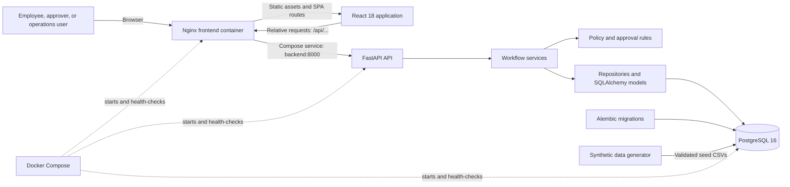
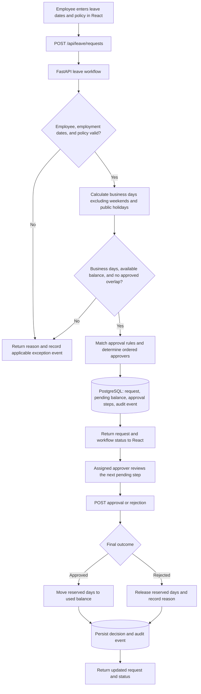
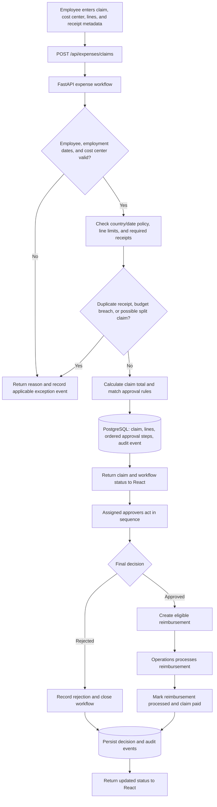
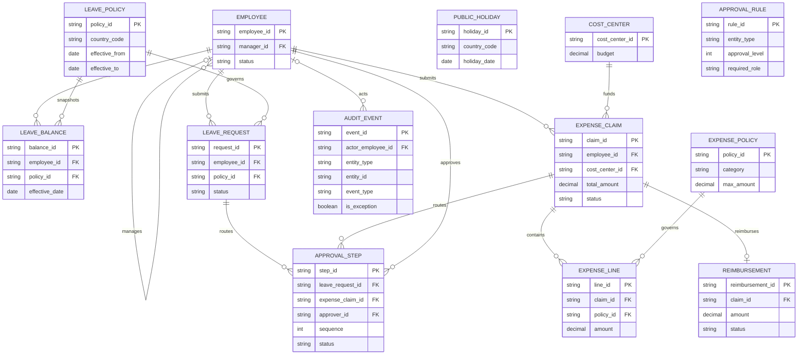

# YottaFlex AI

**A rule-driven employee leave and expense workflow application with policy
checks, sequential approvals, reimbursement tracking, and an audit trail.**

[](https://www.python.org/)
[](https://fastapi.tiangolo.com/)
[](https://react.dev/)
[](https://www.postgresql.org/)
[](https://docs.docker.com/compose/)

YottaFlex AI brings employee leave and expense requests into one workspace.
Despite the project name, the current implementation uses explicit,
deterministic business rules; it does not use a trained AI or machine-learning
model.

## The problem

Leave and expense workflows depend on related information: employee status and
manager, policy and effective dates, leave balances, cost-center budgets,
receipt evidence, and approval authority. When people have to check these
conditions across separate manual steps, it is harder to apply rules
consistently, see why a request was rejected or routed, and retain a useful
decision history.

The challenge describes three groups involved in the workflow:

- **Employees/requesters** need to submit leave dates or itemized expenses with
  the information required for review.
- **Managers and approvers** need to see assigned requests and act in the
  correct approval order.
- **Operations teams** need to monitor statuses, exceptions, reimbursement
  processing, and recorded workflow events.

YottaFlex models those steps in a single application. This is a project
demonstration based on synthetic data, not a claim about a particular
organization's current process.

## Evidence and motivation

The supplied challenge calls for a traceable leave-and-expense workflow,
policy-based decisions, exception paths, reproducible synthetic records, and
measurable evaluation. Those requirements motivated the implementation; they
are not evidence of customer usage or business impact.

**Synthetic dataset evidence:** the checked-in generation summary records seed
`20261022`, 400 employees, 6 leave policies, 800 leave requests, 1,000 expense
claims, 5,415 expense lines, 1,803 approval steps, and 200 reimbursements. It
also records 17 ground-truth labels, 8 anomaly test cases, and a passed
generator validation with zero unlabelled overlaps. These are generated test
records, not real employee or company data. Labeled scenarios include negative
balances, overlapping approved leave, out-of-employment expenses, split claims,
missing receipts/cost centers, duplicate receipts/reimbursements, self-approval,
policy-limit breaches, and threshold routing. Ground truth and anomaly
payloads are kept separate from application seed data.

**Scope & Limitations Note:** This project demonstrates a rule-driven workflow implemented using synthetic test datasets and automated tests (with unit and integration validation). Certain environment-specific test cases (such as PostgreSQL-specific triggers) require a dedicated database configuration and were isolated or skipped during standard local verification.

## The solution

The React workspace submits leave and expense requests to a FastAPI service.
The backend validates the request against employee, policy, balance, cost
center, receipt, and approval-rule data, then stores the request and its
workflow records in PostgreSQL.

For leave, the service calculates business days excluding weekends and
configured public holidays, checks the applicable policy and available balance,
and reserves requested days while approval is pending. Final approval moves
reserved days into used balance; rejection or cancellation releases the
reservation.

For expenses, the service calculates the claim total from its line items and
checks employment dates, active policy, per-line limits, receipt metadata,
duplicate receipt hashes, cost-center budget, and possible split claims. Both
workflows create ordered approval steps using configured rules, including
amount, country, category, and required role. Only the next assigned approver
may act. Approved expense claims can then receive a reimbursement record and
be processed.

Workflow transitions and rejected business decisions are recorded as audit
events with reasons and exception codes where applicable. These are
application rules and stored events; they are not generated AI decisions.

## Key features

### Implemented

- Employee directory, manager hierarchy, leave policies, balances, expense
  policies, and cost centers.
- Leave submission, business-day calculation, balance reservation, overlap and
  insufficient-balance checks, and approval decisions.
- Itemized expense submission with policy, receipt, employment-date, budget,
  duplicate-receipt, and split-claim checks.
- Configurable sequential approval routing and an actionable approver queue.
- Reimbursement creation after final approval and reimbursement processing.
- Request workflow details, status summaries, audit history, and exception
  filtering.
- Deterministic synthetic data generation, integrity validation, CSV/JSON/SQL
  exports, source manifest, and separate ground-truth fixtures.
- Docker Compose deployment with PostgreSQL, FastAPI, and Nginx serving the
  React application and proxying same-origin `/api` requests.

## System architecture



- **React/Vite** provides the employee, approval, operations, audit, and
  analytics screens. The production build is served by **Nginx**.
- **Nginx** serves the single-page application and reverse-proxies `/api/...`
  to the `backend` Compose service; the browser does not need a separate API
  origin.
- **FastAPI** exposes request, approval, reimbursement, audit, and summary
  endpoints. Services coordinate transactions; rule modules make policy and
  approval decisions.
- **SQLAlchemy and PostgreSQL** persist application entities and audit events.
  Alembic applies schema migrations at backend startup.
- **Docker Compose** runs PostgreSQL, backend, and frontend. PostgreSQL uses a
  persistent named volume and is not published on a host port by default.
- **The generator** produces deterministic synthetic inputs and separate
  evaluation labels. Startup seeding loads application entities only into an
  empty database; it skips a non-empty database rather than overwriting it.

## Data flow

### Leave request



### Expense claim



## Database and relationships

The application uses **PostgreSQL 16** in Docker Compose. SQLAlchemy models
define the entities, keys, constraints, and relationships; Alembic migrations
create and evolve the schema. Synthetic data is loaded after migrations when
`SEED_DATA=true` and the application tables are empty.



`LeaveBalance` bridges employees and leave policies and is unique per
employee/policy/effective-date snapshot. `ExpenseLine` bridges claims and
expense policies. Each `ApprovalStep` references exactly one leave request or
expense claim; the two nullable foreign keys are mutually exclusive.
`Reimbursement` is optional and unique per claim. `ApprovalRule` is matched by
workflow logic rather than a direct foreign key. `AuditEvent.entity_type` and
`entity_id` form a polymorphic reference (not a database foreign key); its
optional actor is an employee. `PublicHoliday` is keyed by country and date
uniqueness and is consulted during leave-day calculation.

See the [data dictionary](docs/data_dictionary.md) for field-level details,
validation, lifecycle states, and cardinalities. The schema contains employee
name and email fields, but the committed generated dataset uses synthetic
records.

## Screenshots and visual walkthrough

### Application home/dashboard

The supplied screenshot shows the  home screen.
the available home screenshot is:

![YottaFlex AI analytics screen showing generated employee, expense, workflow, and status summaries]


Capture the home route (`/`) and save it as
`docs/screenshots/home-dashboard.png`.

### Employee/requester workflow

No requester-form screenshot is included yet. From the running app, open
`/leave` and `/expenses`, then capture the respective submission forms as:

- `docs/screenshots/requester-leave-form.png`
- `docs/screenshots/requester-expense-form.png`

### Approver workflow

No approver screenshot is included yet. Open `/approvals` using a synthetic
approver ID and capture the assigned pending steps as
`docs/screenshots/approver-queue.png`.

### Decision/result screens

No decision-result screenshot is included yet. Open a request or claim from
the `/leave` or `/expenses` list, then capture its detail/result page as
`docs/screenshots/decision-results.png`.

### Audit/history views

No audit screenshot is included yet. Capture `/audit` or the audit timeline
on a request/claim detail page as `docs/screenshots/audit-history.png`.

For each capture, run the app using the Docker instructions below, use only
synthetic test records, and place the PNG at the exact repository-relative path
shown. Do not include real personal or confidential information.

## Before and after

This comparison describes the challenge's manual-workflow problem and the
behavior implemented here. It does not claim measured time or cost savings.

| Workflow concern | Manual-process challenge | YottaFlex system-assisted behavior |
|---|---|---|
| Policy checks | Reviewer checks applicability and limits across request details | Services check country, effective dates, employment dates, leave days, expense limits, and required receipt metadata |
| Leave balances | Requester or reviewer tracks available days | Service calculates available balance, reserves pending days, and updates used/reserved amounts on final outcomes |
| Approval routing | Request is passed to the appropriate authority | Rules select approvers; steps are ordered, and only the next assigned step is actionable |
| Exceptions | Rejection reason or issue may be difficult to trace | API returns structured error codes; applicable failures and decisions are recorded as audit events |
| Expense close-out | Claim and reimbursement status are tracked separately | Reimbursement can be created only after final claim approval and then processed through its lifecycle |
| Operational visibility | Statuses are assembled from separate records | UI provides request/claim lists, actionable queue, reimbursement views, audit filters, and summary metrics |


## Run locally with Docker

Requirements: Docker Desktop (or Docker Engine) with Docker Compose V2.

### Prerequisites
Requirements: Docker Desktop (or Docker Engine) with Docker Compose V2.

### Setup

1. **Clone the repository**

   ```powershell
   git clone <https://github.com/nagendra4246/yottaflexai/>
   cd yottaflexai
   ```

2. **Configure environment variables**

   Create a local `.env` file from the example:

   ```powershell
   if (-not (Test-Path .env)) { Copy-Item .env.example .env }
   ```

   Update `POSTGRES_PASSWORD` in `.env` with a local development password. Do not commit `.env` or real credentials to version control.

3. **Build and start the application**

   ```powershell
   docker compose up --build
   ```

   To run the services in the background:

   ```powershell
   docker compose up -d --build
   ```

4. **Access the application**

   - **Web application:** [http://127.0.0.1:8091/](http://127.0.0.1:8091/)
   - **Backend API documentation:** [http://127.0.0.1:8000/docs](http://127.0.0.1:8000/docs)

### Stop the application

```powershell
docker compose down
```

To stop the services and remove the local database volume as well:

```powershell
docker compose down -v
```

4. Open the complete application at **<http://127.0.0.1:8091/>**.

Other useful URLs:

| Purpose | URL |
|---|---|
| Frontend (fixed host mapping) | <http://127.0.0.1:8091/> |
| Frontend (`FRONTEND_PORT`, default `8090`) | <http://127.0.0.1:8090/> |
| Swagger UI | <http://127.0.0.1:8091/api/docs> |
| OpenAPI JSON | <http://127.0.0.1:8091/api/openapi.json> |
| Backend health through Nginx | <http://127.0.0.1:8091/api/health> |

The browser uses relative `/api/...` URLs. Nginx proxies these requests to the
Compose service `backend`; PostgreSQL is internal to Compose and is not
published to the host by default.

Important environment variables:

| Variable | Purpose | Default/requirement |
|---|---|---|
| `POSTGRES_DB` | Database name | `yottaflex` |
| `POSTGRES_USER` | Database user | `yottaflex` |
| `POSTGRES_PASSWORD` | Database password | Required; set locally |
| `FRONTEND_PORT` | Additional loopback frontend port | `8090` |
| `BACKEND_PORT` | Loopback backend port | `8000` |
| `DATABASE_URL` | Optional SQLAlchemy connection override | Compose defaults to the `postgres` service |
| `SEED_DATA` | Load bundled synthetic records into an empty database at startup | `true` |

If overriding `DATABASE_URL` from a container, use `postgres` as the database
hostname. Migrations run at backend startup. Seeding loads application records
only when the database is empty; it does not overwrite existing rows. Use
`docker compose down` to stop services while retaining the database volume.
`docker compose down -v` removes that volume and its database contents.

## Testing and evaluation

Run backend and generator tests from the repository root in PowerShell:

```powershell
$env:PYTHONPATH = (Resolve-Path .\backend).Path
python -m pytest -q
```

Build the frontend:

```powershell
Set-Location .\frontend
npm ci
npm run build
```

Verified for this README update: **45 tests passed, 3 skipped**; frontend
production build succeeded. The skipped tests are PostgreSQL connectivity,
PostgreSQL audit/primary-key trigger, and PostgreSQL end-to-end/ground-truth
checks, which require `TEST_DATABASE_URL` pointing to an appropriate database.
The end-to-end test checks generated labels against API-backed decisions when
that PostgreSQL test environment is available; no matching score is reported
here because that test was skipped.

The generator's own validation summary reports `passed`, 17 ground-truth rows,
8 anomaly cases, and zero unlabelled overlaps for the checked-in seed. These
are synthetic-data integrity results, not production metrics. See
[`generator/README.md`](generator/README.md) for generation and reproducibility
commands.

## Project structure

```text
.
├── backend/
│   ├── app/
│   │   ├── api/          # FastAPI routes
│   │   ├── models/       # SQLAlchemy entities and relationships
│   │   ├── rules/        # Leave, expense, and approval rules
│   │   ├── services/     # Transactional workflows
│   │   └── schemas/      # API request and response models
│   ├── migrations/       # Alembic schema revisions
│   └── tests/            # API, model, service, migration, and PostgreSQL tests
├── data/generated/       # Synthetic seed data and separate evaluation fixtures
├── docs/
│   ├── screenshots/      # Supplied app screenshot; additional captures listed above
│   ├── api.md             # Endpoint reference
│   ├── architecture.md    # Runtime architecture notes
│   ├── business_rules.md  # Workflow decisions and limitations
│   └── data_dictionary.md # Entity fields and relationships
├── frontend/
│   └── src/              # React screens, components, styles, and API client
├── generator/            # Deterministic data generation, export, and validation
├── docker-compose.yml    # PostgreSQL, backend, frontend, ports, and health checks
└── README.md
```

## Future improvements

These are not implemented in the current project:

- Add authenticated identities and role-based authorization for requesters,
  approvers, finance, and operations.
- Add trend and policy-level analytics beyond the current summary counts.
- Define currency conversion rules before comparing budgets across currencies.
- Add operational controls for production use, including managed secrets,
  TLS, backups, monitoring, and deployment hardening.
- Consider seeded-state audit provenance if imported records need a historical
  source trail.

## Further documentation

- [API reference](docs/api.md)
- [Business rules](docs/business_rules.md)
- [Data dictionary and relationships](docs/data_dictionary.md)
- [Architecture and Docker services](docs/architecture.md)
- [Database and migrations](docs/database.md)
- [Synthetic data generator](generator/README.md)
